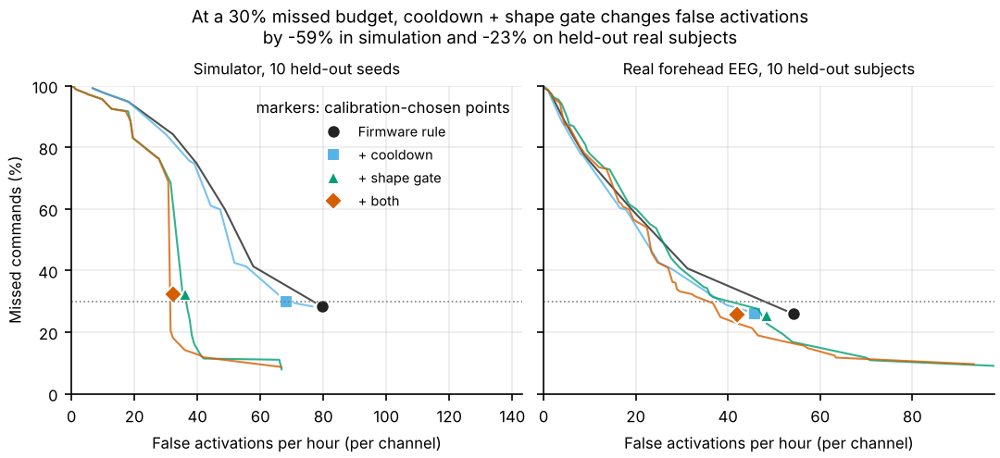
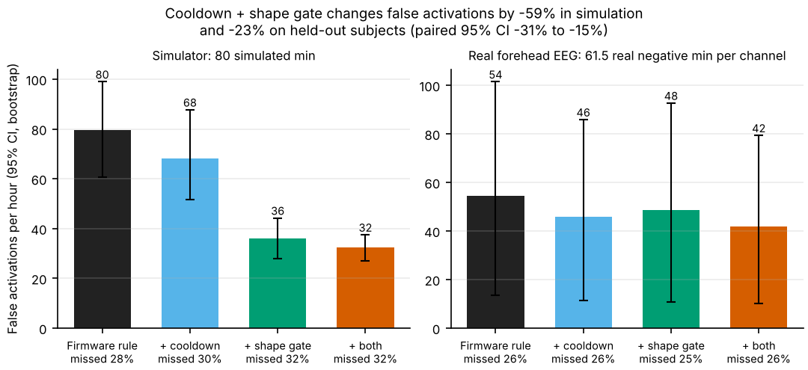

# quiet-blink

How often does a blink-gesture interface fire by accident, and what do a cooldown and a
confidence gate cost in missed commands? Companion study to Montek Kundan's MindClick
(Arduino + BioAmp EXG, one forehead channel, double- and triple-blink commands). People blink
on their own, jaws clench, cables move, so any gesture rule trades accidental activations per
hour against missed commands. This repo ports the firmware's blink path to Python, measures
both sides, and tests two additions.

## Method
- **Port** (`detector.py`) of `control.ino` v0.2.0: notch 48-52 Hz, 45 Hz low-pass, 5 Hz
  high-pass, |x| with 100 ms moving average, in-band test (40, 55), 200 ms debounce, 600 ms
  double/triple windows, `blinkCount` machine. Filters are designed per sample rate (equal to
  the firmware biquads at 512 Hz, tested); deviations are in the module docstring.
  `BLINK_COOLDOWN_MS` only gates the firmware's focus path, so the cooldown here is new.
- **Variants**: firmware rule; + cooldown (ignore blinks 1 s or 3 s after a command); + shape
  gate (one blink = one envelope excursion, bounded duration and peak, optional triple
  regularity); + both.
- **Simulator** (`sim.py`, 512 Hz): 1/f + alpha + 60 Hz, jittered blinks, deliberate
  doubles/triples, natural blinks incl. natural doubles, jaw bursts, baseline steps,
  dropouts. A software test harness, **not** a physiological model.
- **Real negatives**: PhysioNet EEG Motor Movement/Imagery, Fp1/Fpz/Fp2, 20 subjects, runs
  6/10/14 at 160 Hz: 123.3 min per channel. Subjects were not asked to blink in command
  patterns, so a detected command is a *false activation* that may be a natural double blink
  or other ordinary behaviour. Each subject-channel gets a calibration-like gain (median
  candidate blink peak = simulator natural peak). Deliberate commands (simulator templates,
  1.5x natural amplitude) are injected away from natural blinks to measure missed commands.
- **Splits** fixed before modelling: 10 calibration subjects (1,2,3,7,10,13,14,15,16,19) /
  10 held-out (4,5,6,8,9,11,12,17,18,20); simulator seeds 0-9 / 100-109. Each variant's
  operating point is the lowest calibration false rate with calibration missed <= 30%.
  Tables are held-out only; CIs resample whole subjects or seeds; zero-event rates would get a
  rule-of-three bound (none occurred). No learned model: one missed-command budget for all.

## Results (held-out, 30% missed budget; `results/metrics.json`)
Real: 10 subjects, 61.5 negative min per channel (184.5 channel-min), 708 injected commands.
Simulator: 10 seeds, 80 simulated min, 254 commands. FA/h = false activations per channel-hour.

| Variant | Sim FA/h | Sim missed % | Real FA/h [95% CI] | Real missed % | Real change (paired CI) |
|---|---|---|---|---|---|
| Firmware rule (scale 0.8) | 79.5 | 28.3 | 54.3 [13.7, 101.5] | 25.8 | - |
| + cooldown | 68.2 | 29.9 | 45.9 [11.4, 85.9] | 26.1 | -16% [-22%, -5%] |
| + shape gate | 36.0 | 32.3 | 48.5 [10.7, 92.7] | 25.4 | -11% [-23%, +2%] |
| + both | 32.2 | 32.3 | 42.0 [10.1, 79.3] | 25.6 | -23% [-31%, -15%] |

Simulator paired changes: cooldown -14%, gate -55%, both -59%. Unfitted firmware defaults
(40/55) in these units: simulator 47.2 FA/h at 56.9% missed; real, all 20 subjects, 123.3 min
per channel: 13.0 FA/h [5.3, 22.9] at 58.8% missed. Latency from last blink to command on
real data: 695 ms (double) / 91 ms (triple), 806 / 207 ms with the gate.



- Gating helps clearly in the simulator, modestly on real subjects. Held-out per-subject
  rates run 0 to 198 FA/h; subjects 12, 17, 18 carry 84% of the summed rates, and the same
  rule gave 20.4 FA/h on the calibration subjects. Ten subjects leave wide intervals.
- Cooldown alone buys little (-14% sim, -16% real).
- **The in-band window can fire twice for one blink.** A strong blink crosses the window on
  its rising and again on its falling edge; if the excursion outlasts the 200 ms debounce it
  counts twice. At scale 0.8 an isolated blink of envelope peak 30, 45, 67, 90, 135 fires 0,
  1, 1, 2, 2 times, so one hard blink can read as a double. Stronger deliberate blinks hurt
  the firmware rule (missed 28% at 1.5x natural amplitude, 48% at 2.0x), not the gated ones
  (11-12%). On real natural blinks 1.3% of fired excursions re-fired.
- The firmware rule cannot reach a 20% missed budget on calibration (best 22.1% sim, 26.5%
  real); the gate can. On held-out subjects at that budget the gate gives 16.8% missed at 54.0
  FA/h versus 25.8% at 54.3 FA/h: on real data its gain is recall at equal false rate.
- At 6 jaw bursts/min the firmware rule fires 229 FA/h, the gated one 55; at 3x noise 292 vs 93.



## Quickstart
```
pip install -e ".[dev]"
quietblink --data /path/to/eegbci --out results   # S001R06.edf ... S020R14.edf
pytest -q && ruff check . && ruff format --check .
```
Fixed seeds, CPU only, about 45 CPU-s; reruns reproduce `results/metrics.json` (timing aside).

## Limitations
- The missed side rests on simulator assumptions: deliberate amplitude 1.5x natural, 25%
  jitter, 8% natural doubles. Only `deliberate_gain` is swept.
- Injected blinks are simulator templates on real EEG, not real deliberate blinks, and the
  units are not calibrated to MindClick hardware or its ADC. No hardware validation.
- Channels of one subject are correlated: rates are per channel, CIs resample subjects.
  Gate parameters come from a 24-shape grid; scale 0.8 means thresholds 32 / 44 units.

## Citations
- Schalk et al., BCI2000, IEEE Trans. Biomed. Eng. 51(6):1034-1043, 2004.
- Goldberger et al., PhysioBank, PhysioToolkit, and PhysioNet, Circulation 101(23):e215-e220, 2000.
- Hanley and Lippman-Hand, JAMA 249(13):1743-1745, 1983 (rule of three).
- Efron, Ann. Statist. 7(1):1-26, 1979 (bootstrap).
